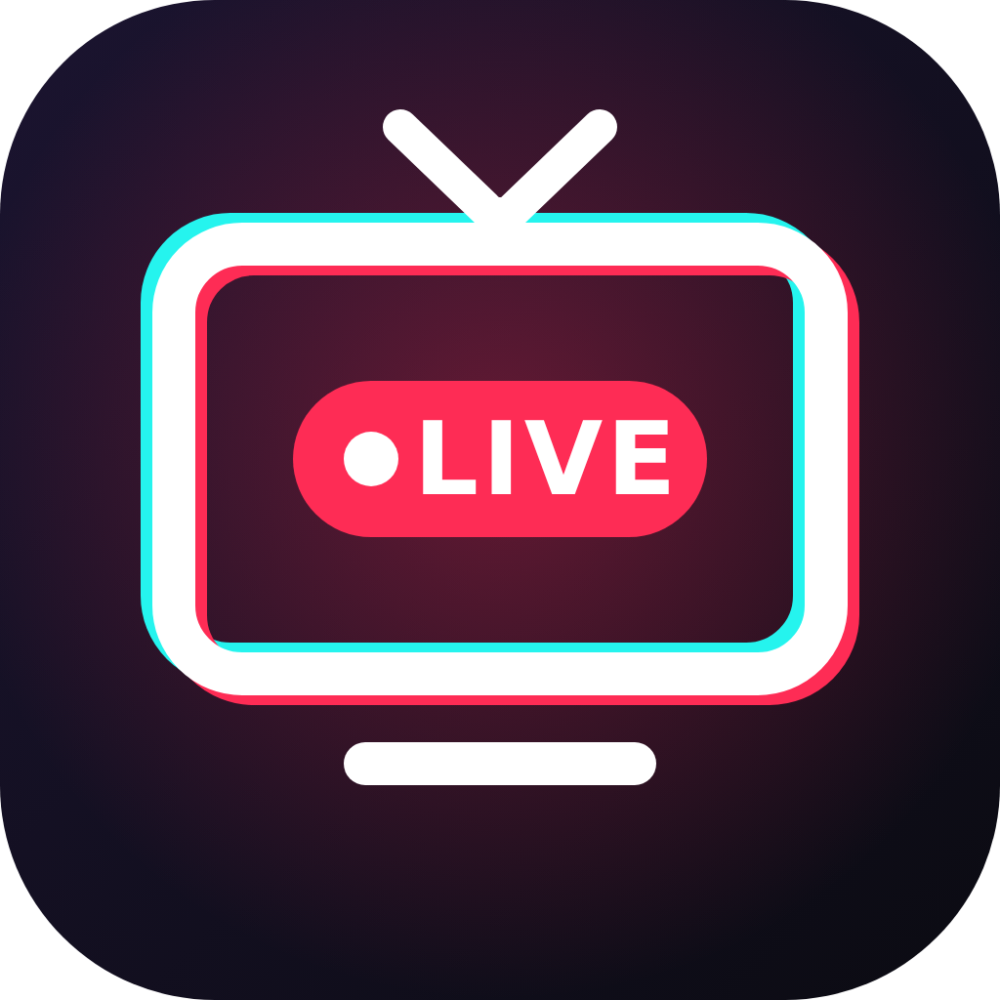

# TokTV: TikTok for Fire TV

**[Download the latest APK](https://github.com/Cyberhex1/TokTV/releases/latest)**

A sideload-only TikTok LIVE app for Fire TV sticks, built for the remote. It opens to a native list of the people you follow who are LIVE right now (no website in the way, so it stays fast on older sticks) and plays LIVEs in a native player. The full tiktok.com site, with a TV control layer, is still one menu away for videos, gifts and search.

## Install on the Fire TV

1. On the Fire TV: Settings > My Fire TV > Developer options > turn on **Apps from Unknown Sources** (or allow it for the Downloader app). If Developer options is hidden: Settings > My Fire TV > About, then click the device name 7 times.
2. Get `TokTV.apk` onto the stick, either:
   - **Downloader app**: upload the APK somewhere with a direct link (Google Drive direct link, Dropbox `?dl=1`, etc.) and enter the URL in Downloader, or
   - **adb from a computer** on the same Wi-Fi: turn on ADB debugging in Developer options, then `adb connect <fire-tv-ip>` and `adb install -r TokTV.apk`.
3. Open **TokTV** from Your Apps & Channels (it shows with its own banner).

Updates: install the new APK over the old one. Your login is kept as long as it's signed with the same key. `build.sh` creates `keystore/toktv.jks` on the first build (set `KEYSTORE_PASS` to choose its password); keep that file, it is not in the repo.

## Log in

Menu > **Log in (QR code)**, then scan the code with the TikTok app on your phone (Profile > ☰ > scan icon in the top corner, or the camera on the login prompt).

## Remote controls

**LIVE list (start screen)**
| Button | Does |
|---|---|
| Arrows / OK | Move between LIVEs / watch one |
| Hold OK, or ≡ (Menu) on a card | Pin to top / Unpin, Sort |
| ≡ (Menu) | Pin, Sort (TikTok's order, Recently watched, Most viewers, Name A–Z), Refresh, Free mouse, website screens, Log in, Settings |
| ⏯ | Refresh the list (it also refreshes every 3 minutes) |
| Back | Press twice to exit |

Pinned creators get their own row at the top; when they're offline they stay there, dimmed. "Recently watched" counts LIVEs watched on this TV (TikTok's website doesn't share LIVE watch history from other devices).

**Free mouse**: turn on in ≡ or Settings. Arrows move a pointer (hold to go faster), OK clicks, hold OK to long-press, push past the top or bottom edge to scroll.

**Videos (For You, Following, a video page)**
| Button | Does |
|---|---|
| ▲ / ▼ | Previous / next video |
| OK | Pause / play. Press twice quickly to Like |
| ▶ | Jump to the video's buttons (Like, Comments, Save, Share, profile). Move with the arrows, OK to press |
| ◀ | Open the TokTV menu |
| Back | Close comments/popups, leave the buttons, then go back a page |
| ≡ (Menu) | Open the TokTV menu |
| ⏯ / ⏩ / ⏪ | Play-pause / next / previous |

**Other pages (Explore, profiles, search, LIVE browse)**: the arrows move a highlighted box, OK clicks it. Hitting ◀ at the left edge opens the menu.

**LIVE (website player)**: ▲ / ▼ switch between Lives, OK turns the sound on, ▶ reaches chat, Follow and the rest of the page.

**LIVE (native player)**: ▲ / ▼ (or ⏪ ⏩) switch Lives, ▶ show chat on the side, ◀ hide chat, OK show stream info, ≡ options (quality, pin, free mouse, chat, website player), Back to the LIVE list.

## Settings (Menu > Settings)

- **LIVE player**: Website (chat, gifts, full page) or **Native Fire TV player**. With Native on, opening any Live, from LIVE browse, a profile, or search, plays it in the native player. If a stream can't be played natively you'll get "Press OK to watch it in the website player".
- **Native player quality**: Auto / Original / Full HD / HD / SD / Low.
- **Chat in native player**: On / Off.
- **Text and layout size**: Extra large / Large / Medium / Small.
- **Turn sound on automatically**: unmutes videos TikTok starts muted.
- **Hide "Get the app" banners**.
- **Log out and clear data**.

## Known limits

- Gifts and coin purchases may not work in the website player.
- Because this runs TikTok's website, a TikTok site change can break a button mapping until the script (`assets/tv.js`) is updated.
- The native player only plays HLS streams. Most Lives have one; if not, it falls back to the website player.

## Building

No Gradle needed. ExoPlayer and its dependencies are listed in `libs.txt`; the build scripts download them into `libs/` and check their SHA-1.

- **Linux**: Android build-tools (`aapt2`, `d8`, `zipalign`, `apksigner`), a JDK 11+, `curl` and `unzip` on the PATH, then `ANDROID_JAR=/path/to/android.jar ./build.sh` (any android.jar from API 30+).
- **Windows**: `build.ps1`, with `ANDROID_SDK` pointing at a folder holding `build-tools\` and `platforms\` and `JAVA_HOME` at a JDK 11+.

Both create `keystore/toktv.jks` on the first build unless `KEYSTORE` points at an existing one (`KEYSTORE_PASS` sets its password). Keep that file and sign every update with it, or the Fire TV won't install the update over the old version.

Layout: `src/com/toktv/app/` (HomeActivity = LIVE list, FeedLoader = gets the lists, LiveActivity = native player, MainActivity = website + menu, Pointer = free mouse, Picks = pins/sort/recent, SettingsActivity), `src/com/google/android/exoplayer2/extractor/flv/TokFlvExtractor.java` (FLV reader with HEVC, which TikTok LIVE uses), `assets/tv.js` (the remote-control layer injected into tiktok.com).